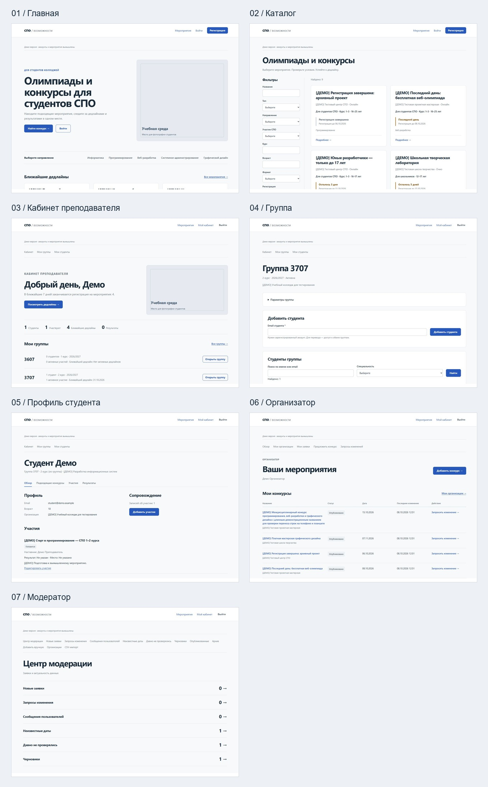

# Визуальная переработка · 8 октября 2026

Обновлён существующий проект. Схема и рабочие данные БД, обработчики изменений,
права, CSRF, GET-фильтры, модерация, группы, участия и правила рекомендаций сохранены.
Добавлены только представления существующих данных и read-only UI helpers.
Новых бизнес-функций, внешних сервисов, UI-фреймворков или сборки нет.

## Дизайн-система

Одна синяя акцентная палитра, светлая поверхность и тёмная типографика.
Тени и градиенты не используются. Цвет выделяет действия, выбранную вкладку,
дедлайн и ошибки. Статусы преимущественно нейтральные; направления представлены
обычным текстом. Рабочие разделы строятся на строках и таблицах, а не сетках KPI.

| Параметр | Значение |
|---|---|
| Основной текст | #192b3a |
| Вторичный текст | #65727e |
| Акцент / hover | #2759bd / #1e4696 |
| Фон / поверхность / граница | #f8f9fa / #ffffff / #dde2e7 |
| Шрифт | Локальный system-ui / Segoe UI, без загрузки шрифтов |
| Текст | 16 px, line-height 1.65 |
| H1 | 32–52 px; hero 40–70 px |
| H2 / H3 | 26 / 18 px, на телефоне H2 22 px |
| Подписи / метаданные | 13–15 px |
| Радиус | Контейнер 10 px, фото 12 px, кнопка 8 px |
| Отступы | 8, 16, 24, 32, 48, 64 px |
| Контент | Максимум 1280 px; поля 32 / 24 / 16 px |
| Кнопки / поля | Высота от 48 / 46 px |
| Таблица | Ячейки 22 px по вертикали; границы строк |

Базовый style.css сохраняет общие правила форм. product.css подключается после него
и задаёт единый визуальный слой всем маршрутам. Стили не зависят от конкретного
имени пользователя или демо-данных.

Основные компоненты: общий header/footer, page-heading, hero с локальным фото,
section-heading, упрощённая competition-card, вертикальный акцент deadline,
stats-grid в одну строку, group-row, work-table, work-list, profile-tabs,
compare-grid, формы и раскрываемые второстепенные действия.

## Что изменилось на страницах

- Главная: hero в две колонки, два CTA, короткая строка направлений, до трёх
  опубликованных мероприятий с открытой регистрацией и краткий блок аудитории.
  Используются прежние catalogResults/catalogFilters. Если подключение БД ещё
  не настроено, гостевая главная остаётся доступной.
- Каталог: спокойные фильтры с теми же GET-параметрами; название, организатор,
  формат, основное условие, дедлайн, до двух направлений и «Подробнее».
  Полные сведения остались на странице мероприятия.
- Преподаватель: приветствие с местом для фотографии; настоящие числа из
  существующих групп и participations. «Ближайшие дедлайны» означает открытые
  регистрации в публичном каталоге в следующие 7 дней, а дедлайн группы — ближайший
  активный дедлайн среди отмеченных участий её студентов.
- Студенты и группа: одна рабочая таблица, текущие участия и результаты
  из имеющихся записей. Исключение осталось POST с CSRF и подтверждением;
  действие раскрывается в строке. Параметры и доступ преподавателей — в details.
- Профиль студента у преподавателя: имя и основные сведения в заголовке,
  вкладки «Обзор / Подходящие конкурсы / Участия / Результаты».
  Вкладки — обычные GET-ссылки; JavaScript не нужен. Обзор показывает два
  мероприятия, отдельная вкладка — прежние первые 12 выбранного соответствия.
  Алгоритм и причины соответствия не изменены.
- Организатор: главный CTA «Добавить конкурс», таблица заявок и опубликованных
  мероприятий. Для опубликованной записи доступен прежний запрос изменения.
  Канонические competitions организатор по-прежнему не редактирует.
- Модератор: центр в виде списка очередей, табличные списки записей,
  крупные блоки «Было / Предлагается». В административных частях фото нет.
- Остальные формы, авторизация, карточка мероприятия, импорт, рекомендации
  и кабинет администратора получают общий новый стиль.

## Локальные изображения

По умолчанию выведены placeholder-блоки. Для замены положите фотографии в
assets/images/home-hero.jpg и assets/images/teacher-welcome.jpg.
Они автоматически используются только на главной и в приветствии преподавателя.
Размеры и кадрирование: [assets/images/README.md](../assets/images/README.md).
Случайных внешних URL и сгенерированных фотографий нет.

## Изменённые и добавленные UI-файлы

| Файл | Изменение |
|---|---|
| assets/css/product.css | Новый общий визуальный слой |
| includes/layout.php | Header/footer, подключение CSS, компактная демо-подпись |
| includes/ui.php | Форматирование, фото-слоты и read-only сводки существующих данных |
| includes/dashboard.php | Общие кабинеты студента и администратора |
| includes/teacher-student-list.php | Адаптивная таблица студентов, существующее действие исключения |
| index.php | Главная с hero и актуальными мероприятиями |
| competitions.php | Упрощённые карточки и фильтры |
| teacher/dashboard.php | Приветствие, статистика, группы, дедлайны, результаты |
| teacher/groups.php | Рабочий список групп |
| teacher/group.php | Группа, состав и компактные формы |
| teacher/students.php | Рабочая страница студентов |
| teacher/student.php | Заголовок профиля, вкладки и сгруппированные данные |
| organizer/dashboard.php | Главный CTA и таблица мероприятий |
| organizer/submissions.php | Таблица заявок и комментариев |
| moderator/dashboard.php | Список очередей |
| moderator/queue.php | Табличные списки модерации |

Дополнительно: assets/images/README.md, этот отчёт, ссылка в README,
docs/ui-screenshots/*.jpg, responsive-checks.json и скрипт создания обзорного листа.
Файлы schema.sql и миграции не изменялись для этого этапа.

## Проверки

- 64 PHP-файла: синтаксис без ошибок.
- tests/full.php: 222 проверки прошли после окончательных правок.
  Набор выполнялся на отдельной spo_test_local_audit и копии приложения,
  не на рабочей БД. Проверены авторизация, роли, CSRF, фильтры, организатор,
  модерация, история, CSV, рекомендации, группы и сопровождение участия.
- В браузере на настоящем Apache: главная, каталог, dashboard преподавателя,
  группа, профиль студента, организатор, модератор и опубликованная очередь.
  Все восемь страниц проверены на 1440, 1024, 768 и 390 px.
- На всех 32 измерениях scrollWidth равен clientWidth. Ширина контента на
  15 px меньше заданного viewport из-за полосы прокрутки. Длинные демо-названия
  и специальности не выходят за границы.
- На телефоне table превращается в подписанные строки с сохранением всех
  полей и действий. Hero и место для фото уменьшаются. Результаты и рекомендации
  корректно показывают пустое состояние.
- Проверены вход/выход через формы, несколько GET-фильтров каталога,
  пустой поиск, вкладки «Результаты» и «Подходящие конкурсы», соответствие
  «Возможно подходит», форма добавления мероприятия и переходы между кабинетами.
- Приложение не записало PHP-предупреждений или ошибок в рабочий logs/php.log
  при этих проверках. Полный функциональный прогон использовал отдельные тестовые данные.

## Скриншоты

Desktop и mobile сохранены для семи запрошенных страниц. Дополнительно сохранена
очередь опубликованных мероприятий модератора.

| Страница | Desktop 1440 px | Mobile 390 px |
|---|---|---|
| Главная | [Скриншот](ui-screenshots/home-1440.jpg) | [Скриншот](ui-screenshots/home-390.jpg) |
| Каталог | [Скриншот](ui-screenshots/catalog-1440.jpg) | [Скриншот](ui-screenshots/catalog-390.jpg) |
| Преподаватель | [Скриншот](ui-screenshots/teacher-dashboard-1440.jpg) | [Скриншот](ui-screenshots/teacher-dashboard-390.jpg) |
| Группа | [Скриншот](ui-screenshots/group-1440.jpg) | [Скриншот](ui-screenshots/group-390.jpg) |
| Профиль студента | [Скриншот](ui-screenshots/student-profile-1440.jpg) | [Скриншот](ui-screenshots/student-profile-390.jpg) |
| Организатор | [Скриншот](ui-screenshots/organizer-1440.jpg) | [Скриншот](ui-screenshots/organizer-390.jpg) |
| Модератор | [Скриншот](ui-screenshots/moderator-1440.jpg) | [Скриншот](ui-screenshots/moderator-390.jpg) |
| Очередь модерации | [Скриншот](ui-screenshots/moderator-queue-1440.jpg) | [Скриншот](ui-screenshots/moderator-queue-390.jpg) |

Измерения: [responsive-checks.json](ui-screenshots/responsive-checks.json).
Все скриншоты сделаны в локальном демо; сведения и аккаунты вымышлены.
